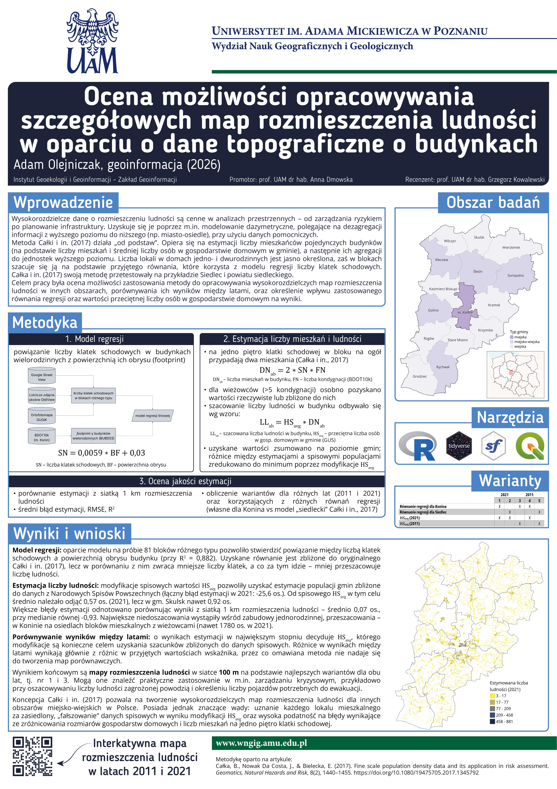

```{r}
#| label: load-packages
library(tidyverse)
library(leaflet)
library(sf)
library(viridis)
```

```{r}
# color palette
pal = cividis(n = 5)

# load grids
grid_2021 = read_sf("data/grid_2021.geojson") %>%
  mutate(col = case_when(
    ludn_grid > 0 & ludn_grid <= 17 ~ pal[5],
    ludn_grid > 17 & ludn_grid <= 77 ~ pal[4],
    ludn_grid > 77 & ludn_grid <= 209 ~ pal[3],
    ludn_grid > 209 & ludn_grid <= 458 ~ pal[2],
    ludn_grid > 458 ~ pal[1],
    .default = NULL
  ))

grid_2011 = read_sf("data/grid_2011.geojson") %>%
  mutate(col = case_when(
    ludn_grid_2011 > 0 & ludn_grid_2011 <= 17 ~ pal[5],
    ludn_grid_2011 > 17 & ludn_grid_2011 <= 77 ~ pal[4],
    ludn_grid_2011 > 77 & ludn_grid_2011 <= 209 ~ pal[3],
    ludn_grid_2011 > 209 & ludn_grid_2011 <= 458 ~ pal[2],
    ludn_grid_2011 > 458 ~ pal[1],
    .default = NULL
  ))

# load borders
gminy = read_sf("data/gminy.geojson")
bbox = gminy %>%
  st_bbox() %>%
  as.character()

```

# Rozmieszczenie ludności {orientation="rows" scrolling="false"}

## Row {.tabset}

```{r}
#| title: "2021"
#| column: screen
#| padding: 0px

grid_2021 %>%
  leaflet(options = leafletOptions(minZoom = 10)) %>%
  addTiles(urlTemplate = "https://{s}.basemaps.cartocdn.com/light_all/{z}/{x}/{y}{r}.png",
           attribution = '&copy; <a href="https://www.openstreetmap.org/copyright">OpenStreetMap</a> contributors &copy; <a href="https://carto.com/attributions">CARTO</a>') %>%
  addPolygons(data = grid_2021,
              color = "black",
              weight = 0.1,
              fillColor = ~col,
              fillOpacity = 0.6,
              label = ~paste0(round(ludn_grid, 1), " os."),
              highlightOptions = highlightOptions(bringToFront = TRUE,
                                                  weight = 0.4)) %>%
  addPolygons(data = gminy,
              fill = FALSE,
              color = "black",
              opacity = 1,
              weight = 1) %>%
  addLegend(colors = rev(pal),
            labels = c("3 – 17", "17 - 77", "77 – 209", "209 – 458", 
                       paste("458 –", round(max(grid_2021$ludn_grid), 0))
                       ),
            title = "Estymowana liczba ludności",
            position = "bottomright") %>%
  fitBounds(bbox[1], bbox[2], bbox[3], bbox[4])
```

```{r}
#| title: "2011"
#| column: screen
#| padding: 0px

grid_2011 %>%
  leaflet(options = leafletOptions(minZoom = 10)) %>%
  addTiles(urlTemplate = "https://{s}.basemaps.cartocdn.com/light_all/{z}/{x}/{y}{r}.png",
           attribution = '&copy; <a href="https://www.openstreetmap.org/copyright">OpenStreetMap</a> contributors &copy; <a href="https://carto.com/attributions">CARTO</a>') %>%
  addPolygons(data = grid_2011,
              color = "black",
              weight = 0.1,
              fillColor = ~col,
              fillOpacity = 0.6,
              label = ~paste0(round(ludn_grid_2011, 1), " os."),
              highlightOptions = highlightOptions(bringToFront = TRUE,
                                                  weight = 0.4)) %>%
  addPolygons(data = gminy,
              fill = FALSE,
              color = "black",
              opacity = 1,
              weight = 1) %>%
  addLegend(colors = rev(pal),
            labels = c("3 – 17", "17 - 77", "77 – 209", "209 – 458", 
                       paste("458 –", round(max(grid_2011$ludn_grid_2011), 0))
                       ),
            title = "Estymowana liczba ludności",
            position = "bottomright") %>%
  fitBounds(bbox[1], bbox[2], bbox[3], bbox[4])
```

# O mapie {orientation="columns" scrolling="false"}

## 

Prezentowane mapy rozmieszczenia ludności w siatce 100 m oparte są na wynikach estymacji liczby ludności, zrealizowanych w ramach pracy inżynierskiej *Ocena możliwości opracowywania szczegółowych map rozmieszczenia ludności w oparciu o dane topograficzne o budynkach*. Opierając się na metodyce Całki i in. (2017), obliczono szacunkowe liczby mieszkańców pojedynczych budynków mieszkalnych, które następnie zagregowano do oczek siatki.

------------------------------------------------------------------------

**Autor**: [Adam Olejniczak](https://github.com/adamolejniczak)

------------------------------------------------------------------------

**Bibliografia:** Całka, B., Nowak Da Costa, J., & Bielecka, E. (2017). Fine scale population density data and its application in risk assessment. *Geomatics, Natural Hazards and Risk*, 8(2), 1440–1455. <https://doi.org/10.1080/19475705.2017.1345792>

------------------------------------------------------------------------

## 


